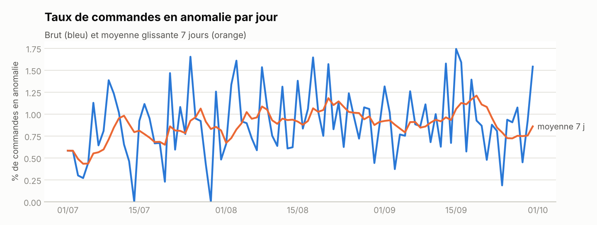
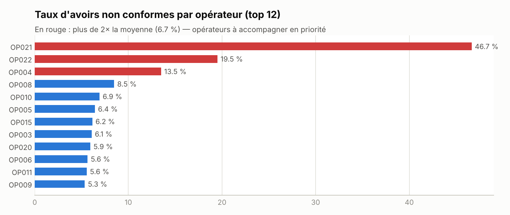

# Contrôle automatisé commandes ↔ factures ↔ avoirs


> **Rapport en ligne (régénéré chaque jour ouvré) : https://ismaildataa.github.io/reconciliation-facturation/**

Pipeline de **qualité et de rapprochement des données de facturation** : il croise les commandes
e-commerce, les factures et les avoirs, détecte les écarts, calcule les KPI quotidiens, **prévient
automatiquement chaque opérateur** de ses avoirs à corriger et publie un rapport de pilotage.

Ce projet reprend, sur des données synthétiques publiables, le type de problématique que j'ai traité
en stage à la direction comptable d'un grand distributeur (rapprochement OMS / facturation, avoirs mal
renseignés, alertes Gmail, reporting Looker Studio).

---

## Le problème métier

Chaque jour, des milliers de commandes doivent être facturées sans erreur. En pratique :

- des commandes ne sont **jamais facturées**, ou le sont **deux fois** ;
- le **montant facturé diffère** du montant commandé ;
- des factures ont une **TVA incohérente** ou une date antérieure à la commande ;
- des **avoirs** sont saisis sans motif, sur une facture inexistante ou pour un montant supérieur à la facture.

Contrôlés à la main dans Excel, ces écarts sont détectés tard, au moment de la clôture.

## Ce que fait le pipeline

```
Données OMS / factures / avoirs
        │
        ├─► 7 règles qualité déclaratives   (src/recon/quality.py)
        ├─► Rapprochement SQL                (sql/01 … 04)
        ├─► KPI quotidiens par Business Unit (sql/03_kpi_quotidiens.sql)
        ├─► E-mails HTML par opérateur + récap service facturation (src/recon/alerts.py)
        └─► Rapport web + export Excel des anomalies à traiter
```

## Résultats (50 000 commandes, 92 jours)

| Indicateur | Valeur |
|---|---|
| Commandes rapprochées sans écart | **99,10 %** |
| Anomalies détectées | **1 096** sur 10 types |
| Montant à risque identifié | **26 569 €** |
| Anomalies injectées retrouvées (rappel) | **100 %** |
| Fausses alertes (précision) | **100 %** — aucune |
| Écarts d'arrondi de ±1 centime correctement ignorés | **150 / 150** |
| Durée d'exécution complète | **~2 secondes** |
| E-mails générés | **23** opérateurs + 1 récapitulatif |

**Comment ces chiffres sont-ils mesurés ?** Le générateur injecte chaque anomalie volontairement et
l'enregistre dans une table de vérité. Le pipeline ne voit pas cette table ; on compare ensuite ce
qu'il a détecté à ce qui avait été injecté. Les règles étant déterministes, le 100 % de rappel était
attendu : l'intérêt du test est surtout de prouver l'**absence de faux positifs**, notamment sur les
écarts d'arrondi, qui sont le piège classique d'un rapprochement de montants.

Un opérateur ressort avec 47 % d'avoirs non conformes contre 6,6 % en moyenne : c'est exactement le
type d'information qui permet au manager de cibler l'accompagnement.




## Démarrage rapide

```bash
git clone https://github.com/ismaildataa/reconciliation-facturation.git
cd reconciliation-facturation
pip install -r requirements.txt
python run_pipeline.py          # ~2 s
pytest -q                       # 5 tests
```

Sorties :

| Fichier | Contenu |
|---|---|
| `docs/index.html` | Rapport de pilotage (publié sur GitHub Pages) |
| `outputs/anomalies_a_traiter.xlsx` | Une feuille par type de contrôle, prête pour les comptables |
| `outputs/alerts/*.html` | Un e-mail par opérateur + récapitulatif |
| `outputs/facturation.db` | Base SQLite pour explorer les tables en SQL |

Options : `--orders 200000` pour un volume plus important, `--send` pour envoyer réellement les
e-mails via SMTP (variables `SMTP_HOST`, `SMTP_USER`, `SMTP_PASSWORD`).

## Choix techniques

- **SQL standard sur SQLite** : le projet tourne partout sans installer de base de données. Les
  requêtes se portent telles quelles sur BigQuery (paramètre `:tolerance` → `@tolerance`).
- **Règles qualité déclaratives** : ajouter un contrôle = ajouter une ligne dans `RULES`, avec sa
  sévérité (bloquant / majeur / mineur). Le rapport se met à jour seul.
- **Tolérance métier explicite** : 5 centimes entre commande et facture, 2 centimes sur HT + TVA = TTC.
  Sans elle, chaque arrondi déclencherait une fausse alerte et les équipes ignoreraient les e-mails.
- **Un enregistrement = une anomalie** dans le jeu de test, pour que la mesure de détection soit exacte.
- **Automatisation** : GitHub Actions régénère et publie le rapport chaque jour ouvré à 7 h —
  l'équivalent d'un Cloud Run déclenché par Cloud Scheduler.

## Structure

```
├── run_pipeline.py            # point d'entrée
├── src/recon/
│   ├── generate_data.py       # données synthétiques + table de vérité
│   ├── quality.py             # moteur de règles qualité
│   ├── reconcile.py           # exécution des requêtes SQL
│   ├── evaluate.py            # rappel / précision de la détection
│   ├── alerts.py              # e-mails HTML (dry-run ou SMTP)
│   └── charts.py              # graphiques du rapport
├── sql/                       # rapprochement, contrôle avoirs, KPI, dates
├── templates/                 # rapport et e-mails (Jinja2)
├── tests/
└── .github/workflows/         # tests + rapport quotidien
```

## Pistes d'évolution

- Brancher les sources réelles (BigQuery, API de facturation) à la place du générateur.
- Historiser les résultats pour suivre le délai moyen de correction des avoirs.
- Envoyer les alertes via l'API Gmail ou un webhook Teams / Slack.

---

**Ismail Yahyaoui** — Data Analyst · [Portfolio](https://ismaildataa.github.io) ·
[LinkedIn](https://www.linkedin.com/in/ismail-yahyaoui-data-analyst/) · yahyaoui.ismail.pro@gmail.com
